

  

  
  
  
  

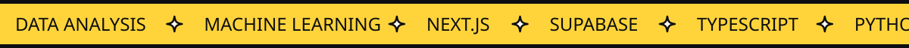

 

Hi! I'm **Wahyu Surya** 👋 — a **Game Developer**, currently working as a **Technical Designer at RIVRS**.
Outside of games, I work with data and build web products from scratch to launch.

- 🎮 &nbsp;Game development & technical design
- 📊 &nbsp;Data & AI — analysis, predictive models, dashboards
- 🛠️ &nbsp;Full-stack web — Next.js + Supabase
- 📫 &nbsp;[wahyuarizeina@gmail.com](mailto:wahyuarizeina@gmail.com) · [LinkedIn](https://www.linkedin.com/in/wahyu-surya-124703283/)

 


  <a href="https://tofavgame.com"></a>
  <a href="https://github.com/wahyuarizeina/Analisis-Data-Elektoral-Pemilu-2024-Indonesia"></a>

  <a href="https://kita-punya-project.vercel.app"></a>
  <a href="https://markalani-music.vercel.app"></a>

 


  

 


  <picture>
    <source media="(prefers-color-scheme: dark)" srcset="assets/snake-dark.svg" />
    <source media="(prefers-color-scheme: light)" srcset="assets/snake-light.svg" />
    
  </picture>

 

  <a href="mailto:wahyuarizeina@gmail.com"></a>

