<p align="center">
  
</p>

<p align="center">
  <a href="https://www.linkedin.com/in/wahyu-surya-124703283/"></a>
  <a href="mailto:wahyuarizeina@gmail.com"></a>
  <a href="https://github.com/wahyuarizeina?tab=followers"></a>
  
</p>


<br />


Halo! Aku **Wahyu Surya** 👋 — analis data yang juga suka membangun produk web dari nol sampai rilis.
Buatku, data dan kode itu satu paket: data memberi tahu *apa* yang perlu dibangun, kode yang mewujudkannya.

- 📊 &nbsp;**Data & AI** — EDA, segmentasi (K-Means), model prediktif, dan dashboard yang mudah dibaca.
- 🛠️ &nbsp;**Full-stack web** — UI Next.js, database Supabase dengan RLS, payment gateway, sampai dasbor admin.
- 🔭 &nbsp;**Sedang mengerjakan** — storefront top-up game **Tofav Game**.
- 🌱 &nbsp;**Sedang mendalami** — model prediktif dan visualisasi data yang jujur.
- 💬 &nbsp;**Ajak ngobrol soal** — analisis data pemilu, Next.js + Supabase, dashboard, dan automasi.
- 📫 &nbsp;**Hubungi aku** — [wahyuarizeina@gmail.com](mailto:wahyuarizeina@gmail.com) atau [LinkedIn](https://www.linkedin.com/in/wahyu-surya-124703283/).

```python
class WahyuSurya:
    peran   = ["AI & Data Analyst", "Full-Stack Web Developer"]
    asal    = "Indonesia 🇮🇩"
    stack   = {
        "data": ["Python", "pandas", "scikit-learn", "Jupyter"],
        "web":  ["Next.js", "TypeScript", "Tailwind CSS", "Supabase"],
        "rilis": ["Playwright", "GitHub Actions", "Vercel"],
    }

    def motto(self) -> str:
        return "Data tanpa cerita cuma angka. Produk tanpa pengguna cuma kode."
```

<br />


<p align="center">
  <a href="https://github.com/wahyuarizeina/Analisis-Data-Elektoral-Pemilu-2024-Indonesia"></a>
  
</p>
<p align="center">
  <a href="https://kita-punya-project.vercel.app"></a>
  <a href="https://raksalab.vercel.app"></a>
</p>
<p align="center">
  <a href="https://markalani-music.vercel.app"></a>
  
</p>

<details>
<summary><b>🔍 Sorotan dari analisis Pemilu 2024</b></summary>
<br />

| Temuan | Angka |
| --- | --- |
| Segmentasi provinsi (K-Means) | **4 cluster** — Urban Progressive, Rural Traditional, Swing Moderate, Emerging Region |
| Model prediksi partisipasi (Gradient Boosting) | **R² 0,585** — penetrasi internet jadi fitur #1 |
| Simulasi kursi DPR (Sainte-Laguë) | PDIP 99 · Golkar 91 · Gerindra 79 · PKB 63 |
| Partai lolos ambang 4% | **9 partai** |

[](https://colab.research.google.com/github/wahyuarizeina/Analisis-Data-Elektoral-Pemilu-2024-Indonesia/blob/main/Analisis_Elektoral_Pemilu_2024_Colab.ipynb)
[](https://elektoralpemilu2024.vercel.app)

</details>

<br />


<p align="center">
  
</p>

<br />


<p align="center">
  
</p>

<br />


<p align="center">
  <picture>
    <source media="(prefers-color-scheme: dark)" srcset="assets/snake-dark.svg" />
    <source media="(prefers-color-scheme: light)" srcset="assets/snake-light.svg" />
    
  </picture>
</p>

<br />

<p align="center">
  <a href="mailto:wahyuarizeina@gmail.com"></a>
</p>
